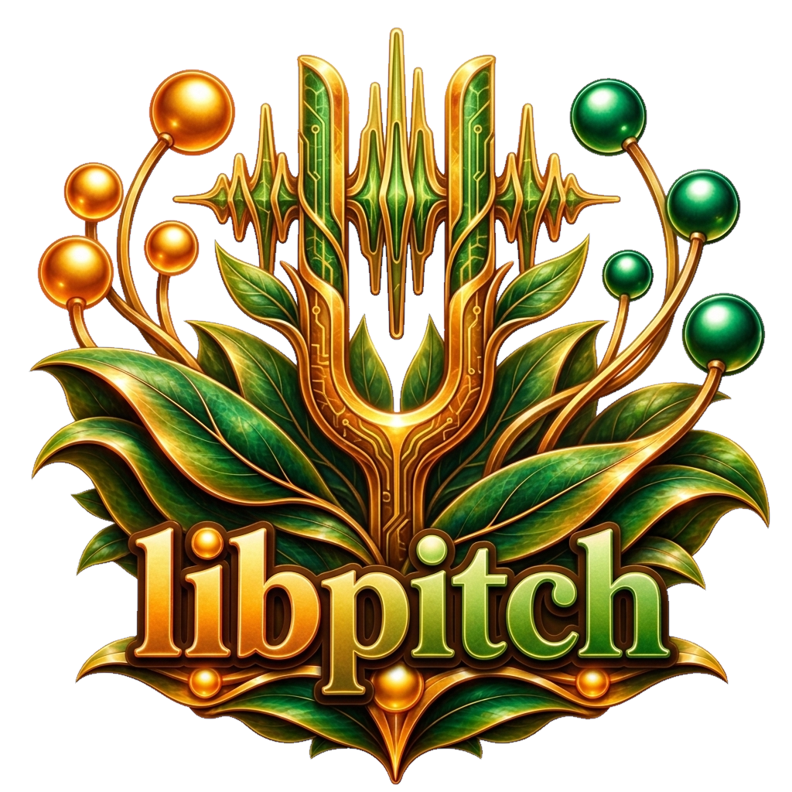

<p align="center">
  
</p>

# @tty-pt/pitch

[](https://www.npmjs.com/package/@tty-pt/pitch)
[](https://github.com/tty-pt/libpitch/blob/main/LICENSE)
[](#)
[](#)
[](#)
[](#)

> Universal Node.js and Browser bindings for **`libpitch`**, the pure-C musical chord detection, key signature analysis, semitone transposition, and lyrics column-alignment engine. Canonical C header: `<ttypt/pitch.h>`.

📖 **Full C & Music Theory Documentation**: See the main [**libpitch GitHub README**](https://github.com/tty-pt/libpitch#readme) for the chord grammar specification, enharmonic spelling rules, and C AST (`pitch_song_t`) API.

---

## 1. Overview & Domain Concepts

`libpitch` (`@tty-pt/pitch`) parses, analyzes, and transposes plain-text chord-over-lyric song charts with zero external chord dictionaries:

1. **Grammar-Based Chord Detection**:
   - Identifies chord lines vs. lyric lines via a single-pass left-to-right grammar (`root` + accidental + quality/extension/suspension/alteration + optional `/bass`), handling complex jazz extensions (`Cmaj9#11/G`, `F#m7b5`) without false positives on ordinary words.
2. **Automatic Key Signature Inference (`getDetectedKey`)**:
   - Infers the song's chromatic tonic (`0..11`) from progression weights to select musically natural enharmonic spellings during transposition.
3. **Column-Preserving Lyric Alignment**:
   - Adjusts horizontal spacing when chord widths expand or shrink (e.g., `C` $\rightarrow$ `C#` or `Do` $\rightarrow$ `Reb`), keeping chords anchored above their exact syllable.
4. **Notation & Rendering Flags**:
   - Supports Anglo-American (`C D E F G A B`) and Latin/Romance solfege (`Do Re Mi Fa Sol La Si` via `PITCH_LATIN`), flats vs. sharps (`PITCH_BEMOL`), HTML output (`PITCH_HTML`), chord-only or lyric-only views, and slash-chord line breaking.

---

## 2. Installation

```bash
npm install @tty-pt/pitch
```

**Native OS Packages (`tty.pt`)**: Prebuilt native C packages (`libpitch`) for Linux (`apt`, `apk`, `pacman`, `dnf`), macOS (`brew`), Windows (`winget`, MSYS2), and OpenBSD (`pkg_add`) are available via the [**tty.pt package repositories**](https://github.com/tty-pt/ci/blob/main/docs/install.md).

---

## 3. Quickstart

```typescript
import {
  transposeText,
  getDetectedKey,
  getShiftTable,
  PITCH_HTML,
  PITCH_BEMOL,
  PITCH_LATIN
} from "@tty-pt/pitch";

const chart = [
  "C       G/B     Am      F",
  "Singing in the morning sun"
].join("\n");

// 1. Transpose up 2 semitones and render HTML
const html = transposeText(chart, 2, PITCH_HTML);
console.log(html);
// <div><b>D       A/C#    Bm      G</b></div><div>Singing in the morning sun</div>

// 2. Transpose to flat enharmonics in Latin solfege (Do, Re, Mi...)
const solfege = transposeText(chart, 3, PITCH_BEMOL | PITCH_LATIN);
console.log(solfege);

// 3. Inspect detected chromatic key (0 = C, 2 = D, ...) & key shift options
console.log("Detected key index:", getDetectedKey());
console.log("Key shift table HTML:", getShiftTable(0));
```

---

## 4. JavaScript / TypeScript API Reference

### `transposeText(text: string, semitones: number, flags?: number): string`
Parses `text`, shifts all detected chords by `semitones` (positive or negative), and formats the output according to `flags`.

### Key Analysis & Shift Table Helpers
- `getDetectedKey(): number`: Returns the detected chromatic tonic (`0..11`, where `0 = C`, or `-1` if no chords were found).
- `resetKey(): void`: Resets the sticky key state on the shared pitch context so the next chart re-detects its key from scratch.
- `getShiftTable(latin?: number): string`: Renders `<option>` tags for all 12 semitone transpositions relative to the detected key (`latin = 1` for `Do Re Mi` labels).

### Formatting Flags Bitmask
| Constant | Value | Description |
| :--- | :--- | :--- |
| `PITCH_HIDE_CHORDS` | `0x01` | Strip chord lines and emit lyrics only |
| `PITCH_HIDE_LYRICS` | `0x02` | Strip lyric lines and emit chords only |
| `PITCH_HTML` | `0x04` | Wrap chord (`<div><b>...</b></div>`) and lyric lines in HTML |
| `PITCH_BEMOL` | `0x08` | Prefer flat enharmonic spellings (`Bb`, `Eb`) over sharps |
| `PITCH_REMOVE_COMMENTS` | `0x10` | Strip `{...}` / `[...]` performance comment annotations |
| `PITCH_BREAK_SLASH` | `0x20` | Break slash bass notes onto a secondary alignment line |
| `PITCH_LATIN` | `0x80` | Render chord roots in Romance/Latin solfege (`Do`, `Re`, `Mi`, ...) |

### `getPitchWasm(): WebAssembly.Instance`
Returns the initialized `pitch.wasm` reactor instance on `@tty-pt/stele`'s shared linear memory substrate.

---

## 5. C Development Headers & Native Integration

```makefile
CFLAGS += -I./node_modules/@tty-pt/pitch/include
LDLIBS += -lpitch
```

---

## License

BSD-2-Clause — Copyright (c) 2026, Paulo Quirino <quirinpa@gmail.com>. See [LICENSE](https://github.com/tty-pt/libpitch/blob/main/LICENSE).
